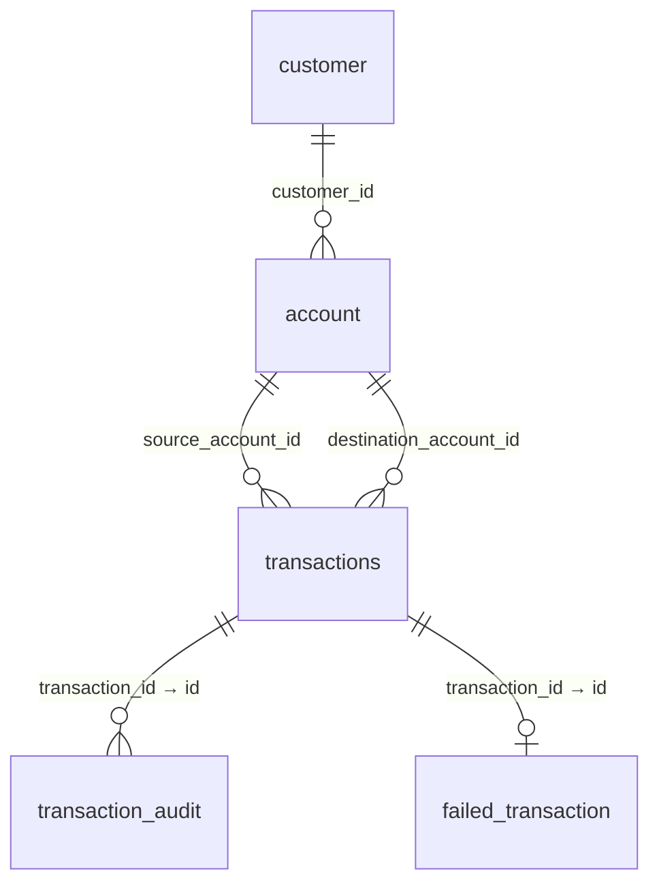

# Database Document – Banking Transaction System

This document describes the MySQL database used by the **Banking Transaction System** (Spring Boot) application: how to create it, the five tables, their columns, constraints and relationships. It matches the live schema of `banking_transaction_db`.

- **Database:** `banking_transaction_db`
- **Engine:** InnoDB (needed for foreign keys and transactions)
- **Charset / collation:** `utf8mb4` / `utf8mb4_0900_ai_ci`
- **Tables:** `customer`, `account`, `transactions`, `transaction_audit`, `failed_transaction`

---

## 1. Setup

Open a terminal and log in to MySQL as root:

```bash
mysql -u root -p
```

Create the database and switch to it:

```sql
CREATE DATABASE banking_transaction_db;
USE banking_transaction_db;
```

Check that it was created:

```sql
SHOW DATABASES;
```

> Create the tables **in the order below**. Every table except `customer` has a foreign key to a table above it: `account` → `customer`, `transactions` → `account`, and `transaction_audit` / `failed_transaction` → `transactions`.

---

## 2. Relationships



- One **customer** can have many **accounts**.
- A **transaction** has a source account, a destination account, or both:

  | Type | source_account_id | destination_account_id |
  |---|---|---|
  | DEPOSIT | NULL | the account |
  | WITHDRAWAL | the account | NULL |
  | TRANSFER | sender | receiver |

- Every transaction has one or more **transaction_audit** rows.
- A failed or rejected transaction has **exactly one** **failed_transaction** row that gives the reason (`transaction_id` is UNIQUE).
- Both log tables point to the numeric `transactions.id` (BIGINT) with a real foreign key, **not** to the business ID `transactions.transaction_id` (`TXN-…`).
- Because of these foreign keys, a `transactions` row must be saved **before** its audit or failure row. A request that is rejected must therefore first be saved in `transactions` with status `REJECTED` (or `FAILED`), and only then can its `failed_transaction` row be written.

---

## 3. Tables

### 3.1 `customer`

Stores bank customers.

```sql
CREATE TABLE customer (
  customer_id BIGINT NOT NULL AUTO_INCREMENT,
  name        VARCHAR(100) NOT NULL,
  email       VARCHAR(150) NOT NULL,
  phone       VARCHAR(15) NOT NULL,
  created_at  DATETIME NOT NULL DEFAULT CURRENT_TIMESTAMP,
  PRIMARY KEY (customer_id),
  UNIQUE KEY email (email),
  UNIQUE KEY phone (phone)
) ENGINE=InnoDB;
```

| Column | Type | Null | Key | Default | Description |
|---|---|---|---|---|---|
| customer_id | BIGINT | NO | PK | auto_increment | Unique customer ID |
| name | VARCHAR(100) | NO | | | Full name |
| email | VARCHAR(150) | NO | UNIQUE | | Email, one per customer |
| phone | VARCHAR(15) | NO | UNIQUE | | Phone number, one per customer |
| created_at | DATETIME | NO | | CURRENT_TIMESTAMP | When the customer was added |

**Entity:** `Customer` (`@Table(name = "customer")`)

---

### 3.2 `account`

Stores bank accounts. Each account belongs to one customer.

```sql
CREATE TABLE account (
  account_id     BIGINT NOT NULL AUTO_INCREMENT,
  customer_id    BIGINT NOT NULL,
  account_number VARCHAR(20) NOT NULL,
  balance        DECIMAL(19,2) NOT NULL DEFAULT 0.00,
  status         VARCHAR(20) NOT NULL DEFAULT 'ACTIVE',
  created_at     DATETIME NOT NULL DEFAULT CURRENT_TIMESTAMP,
  PRIMARY KEY (account_id),
  UNIQUE KEY account_number (account_number),
  KEY idx_account_customer (customer_id),
  CONSTRAINT fk_account_customer FOREIGN KEY (customer_id) REFERENCES customer (customer_id),
  CONSTRAINT chk_account_balance CHECK (balance >= 0),
  CONSTRAINT chk_account_status CHECK (status IN ('ACTIVE','INACTIVE','FROZEN'))
) ENGINE=InnoDB;
```

| Column | Type | Null | Key | Default | Description |
|---|---|---|---|---|---|
| account_id | BIGINT | NO | PK | auto_increment | Unique account ID |
| customer_id | BIGINT | NO | FK → customer | | Owner of the account |
| account_number | VARCHAR(20) | NO | UNIQUE | | Account number |
| balance | DECIMAL(19,2) | NO | | 0.00 | Current balance, never negative |
| status | VARCHAR(20) | NO | | 'ACTIVE' | `ACTIVE`, `INACTIVE` (closed) or `FROZEN` |
| created_at | DATETIME | NO | | CURRENT_TIMESTAMP | When the account was opened |

**Constraints and indexes**
- `fk_account_customer`: the customer must exist.
- `chk_account_balance`: the balance can never go below 0.
- `chk_account_status`: only the three allowed statuses. These are the same names as the Java enum `AccountStatus`, which is stored with `@Enumerated(EnumType.STRING)`.
- `idx_account_customer`: fast "accounts of a customer" lookups.

**Entity:** `Account`

---

### 3.3 `transactions`

Stores every deposit, withdrawal and transfer, whether it succeeded, failed or was rejected.

> The table is named `transactions` (plural) because `TRANSACTION` is a reserved word in MySQL. No backticks are needed in queries.

```sql
CREATE TABLE transactions (
  id                     BIGINT NOT NULL AUTO_INCREMENT,
  transaction_id         VARCHAR(64) NOT NULL,
  type                   VARCHAR(20) NOT NULL,
  amount                 DECIMAL(19,2) NOT NULL,
  source_account_id      BIGINT DEFAULT NULL,
  destination_account_id BIGINT DEFAULT NULL,
  status                 VARCHAR(20) NOT NULL,
  created_at             DATETIME NOT NULL DEFAULT CURRENT_TIMESTAMP,
  PRIMARY KEY (id),
  UNIQUE KEY transaction_id (transaction_id),
  KEY idx_transaction_source (source_account_id),
  KEY idx_transaction_destination (destination_account_id),
  KEY idx_transaction_created (created_at),
  KEY idx_transaction_type_status (type, status),
  CONSTRAINT fk_transaction_destination FOREIGN KEY (destination_account_id) REFERENCES account (account_id),
  CONSTRAINT fk_transaction_source FOREIGN KEY (source_account_id) REFERENCES account (account_id),
  CONSTRAINT chk_transaction_amount CHECK (amount > 0),
  CONSTRAINT chk_transaction_status CHECK (status IN ('SUCCESS','FAILED','REJECTED')),
  CONSTRAINT chk_transaction_type CHECK (type IN ('DEPOSIT','WITHDRAWAL','TRANSFER'))
) ENGINE=InnoDB;
```

| Column | Type | Null | Key | Default | Description |
|---|---|---|---|---|---|
| id | BIGINT | NO | PK | auto_increment | Internal row ID (used by the log tables) |
| transaction_id | VARCHAR(64) | NO | UNIQUE | | Business ID, e.g. `TXN-<uuid>` |
| type | VARCHAR(20) | NO | INDEX (with status) | | `DEPOSIT`, `WITHDRAWAL` or `TRANSFER` |
| amount | DECIMAL(19,2) | NO | | | Amount, must be greater than 0 |
| source_account_id | BIGINT | YES | FK → account | NULL | Account debited (NULL for deposit) |
| destination_account_id | BIGINT | YES | FK → account | NULL | Account credited (NULL for withdrawal) |
| status | VARCHAR(20) | NO | INDEX (with type) | | `SUCCESS`, `FAILED` or `REJECTED` |
| created_at | DATETIME | NO | INDEX | CURRENT_TIMESTAMP | When the transaction happened |

**Constraints and indexes**
- `fk_transaction_source`, `fk_transaction_destination`: the referenced accounts must exist.
- `chk_transaction_amount`: amount must be greater than 0.
- `chk_transaction_type`: only `DEPOSIT`, `WITHDRAWAL`, `TRANSFER` (Java enum `TransactionType`).
- `chk_transaction_status`: only `SUCCESS`, `FAILED`, `REJECTED` (Java enum `TransactionStatus`). There is no default, so the application must always set the status.
- `idx_transaction_source`, `idx_transaction_destination`: fast "transactions of an account" lookups.
- `idx_transaction_created`: fast date-range queries and statements.
- `idx_transaction_type_status`: fast reports such as "all failed transfers".

**Entity:** `BankTransaction` (`@Table(name = "transactions")`)

---

### 3.4 `transaction_audit`

Audit log of each operation on a transaction: which thread handled it, the result and how long it took.

```sql
CREATE TABLE transaction_audit (
  audit_id        BIGINT NOT NULL AUTO_INCREMENT,
  transaction_id  BIGINT NOT NULL,
  event_timestamp DATETIME NOT NULL DEFAULT CURRENT_TIMESTAMP,
  thread_name     VARCHAR(100) DEFAULT NULL,
  operation       VARCHAR(30) NOT NULL,
  result          VARCHAR(20) NOT NULL,
  duration_ms     BIGINT DEFAULT NULL,
  PRIMARY KEY (audit_id),
  KEY idx_audit_transaction (transaction_id),
  KEY idx_audit_timestamp (event_timestamp),
  CONSTRAINT fk_audit_transaction FOREIGN KEY (transaction_id) REFERENCES transactions (id)
) ENGINE=InnoDB;
```

| Column | Type | Null | Key | Default | Description |
|---|---|---|---|---|---|
| audit_id | BIGINT | NO | PK | auto_increment | Unique audit row ID |
| transaction_id | BIGINT | NO | FK → transactions.id | | Transaction being audited |
| event_timestamp | DATETIME | NO | INDEX | CURRENT_TIMESTAMP | When the event was logged |
| thread_name | VARCHAR(100) | YES | | NULL | Server thread that processed it |
| operation | VARCHAR(30) | NO | | | Operation performed, e.g. `DEPOSIT`, `WITHDRAWAL`, `TRANSFER` |
| result | VARCHAR(20) | NO | | | Outcome of the operation, e.g. `SUCCESS`, `FAILED`, `REJECTED` |
| duration_ms | BIGINT | YES | | NULL | Time taken in milliseconds |

**Constraints and indexes**
- `fk_audit_transaction`: the transaction must exist in `transactions`.
- `idx_audit_transaction`: fast "audit trail of a transaction" lookups.
- `idx_audit_timestamp`: fast time-range queries on the log.

**Entity:** `TransactionAudit`

---

### 3.5 `failed_transaction`

Stores the reason for every failed or rejected transaction.

```sql
CREATE TABLE failed_transaction (
  failed_id      BIGINT NOT NULL AUTO_INCREMENT,
  transaction_id BIGINT NOT NULL,
  error_category VARCHAR(50) NOT NULL,
  reason         VARCHAR(500) NOT NULL,
  created_at     DATETIME NOT NULL DEFAULT CURRENT_TIMESTAMP,
  PRIMARY KEY (failed_id),
  UNIQUE KEY transaction_id (transaction_id),
  KEY idx_failed_category (error_category),
  CONSTRAINT fk_failed_transaction FOREIGN KEY (transaction_id) REFERENCES transactions (id)
) ENGINE=InnoDB;
```

| Column | Type | Null | Key | Default | Description |
|---|---|---|---|---|---|
| failed_id | BIGINT | NO | PK | auto_increment | Unique row ID |
| transaction_id | BIGINT | NO | UNIQUE, FK → transactions.id | | Transaction that failed (one row per transaction) |
| error_category | VARCHAR(50) | NO | INDEX | | Category of failure (see below) |
| reason | VARCHAR(500) | NO | | | Readable explanation |
| created_at | DATETIME | NO | | CURRENT_TIMESTAMP | When the failure was recorded |

**Constraints and indexes**
- `fk_failed_transaction`: the transaction must exist in `transactions`.
- `transaction_id` (UNIQUE): only one failure row per transaction. The unique index also makes "why did this transaction fail" lookups fast.
- `idx_failed_category`: fast reports grouped by error category.

**Entity:** `FailedTransaction`

**Error categories**

The database does not restrict `error_category` with a CHECK constraint; the application decides the allowed values. Suggested values:

| Value | Meaning |
|---|---|
| `INSUFFICIENT_BALANCE` | Withdrawal/transfer amount is more than the balance |
| `INVALID_ACCOUNT` | Account does not exist, is closed, or source = destination |
| `ACCOUNT_FROZEN` | Account is frozen |
| `INVALID_AMOUNT` | Amount is invalid |
| `TIMEOUT` | Operation timed out |
| `DUPLICATE_TRANSACTION` | Same transaction submitted twice |

---

## 4. Verify the tables

```sql
SHOW TABLES;

SHOW CREATE TABLE customer\G
SHOW CREATE TABLE account\G
SHOW CREATE TABLE transactions\G
SHOW CREATE TABLE transaction_audit\G
SHOW CREATE TABLE failed_transaction\G
```

`SHOW TABLES;` should list exactly these five tables. Each `SHOW CREATE TABLE` output should match the SQL above.

---

## 5. How the application uses the database

- Connection settings are in `banking-transaction-system/src/main/resources/application.properties` (`spring.datasource.url=jdbc:mysql://localhost:3306/banking_transaction_db`).
- The tables are created by hand with the SQL in this document. The JPA entities in `entity/` must match them exactly.
- `spring.jpa.hibernate.ddl-auto` is currently `update`. With `update`, Hibernate tries to change the tables on startup when an entity does not match (for example, it adds missing columns or tries to change a column type), which can silently change the schema or fail with a DDL error. Setting it to `validate` is recommended: Hibernate then never changes the tables, and the app refuses to start with a clear message if an entity does not match this schema.
- Planned flow for a transaction:
  - **Success:** the balance update, the `transactions` row (`SUCCESS`) and a `transaction_audit` row are saved together in one database transaction.
  - **Failure / rejection:** the balance change is rolled back. A `transactions` row (`FAILED` or `REJECTED`) is saved first, then its `failed_transaction` row and a `transaction_audit` row, in a separate database transaction so the failure stays on record.

---

## 6. Notes

1. **Same link column in both log tables.** `transaction_audit.transaction_id` and `failed_transaction.transaction_id` are both BIGINT and point to `transactions.id`, not to the business ID. Join like this:
   ```sql
   SELECT * FROM transactions t JOIN transaction_audit  a ON a.transaction_id = t.id;
   SELECT * FROM transactions t JOIN failed_transaction f ON f.transaction_id = t.id;
   ```
2. **Upper-case values everywhere.** Account statuses, transaction types and statuses are upper case and must match the Java enum names exactly, because they are stored with `EnumType.STRING`. Use upper case for error categories too.
3. **One failure row per transaction.** Because `failed_transaction.transaction_id` is UNIQUE, saving a second failure for the same transaction fails with a duplicate-key error.
