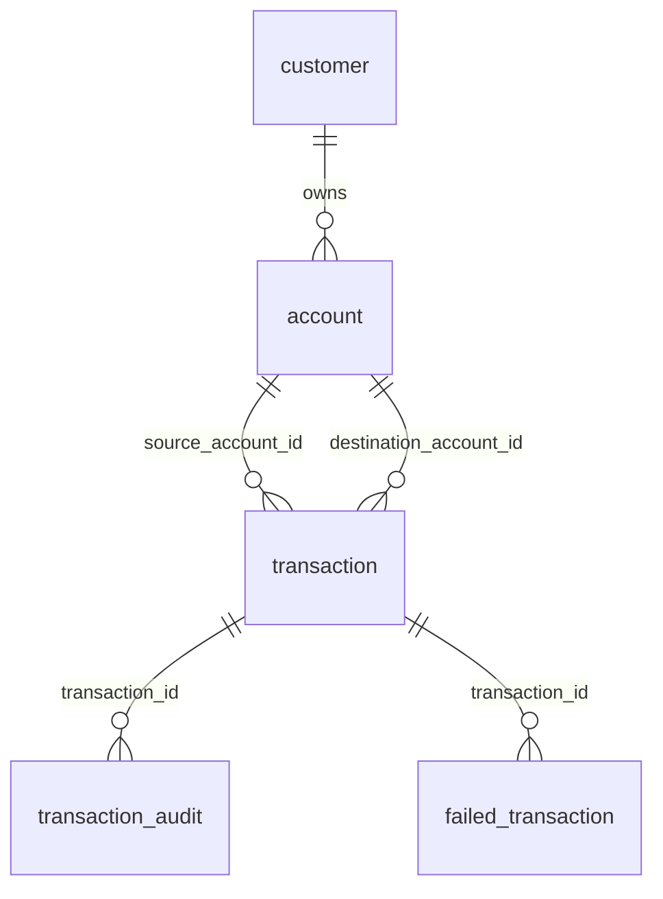

# Database Document – Banking Transaction System

This document describes the MySQL database used by the **Banking Transaction System** (Spring Boot) application: how to create it, the five tables, their columns, constraints and relationships.

- **Database:** `banking_transaction_db`
- **Engine:** InnoDB (needed for foreign keys and transactions)
- **Tables:** `customer`, `account`, `transaction`, `transaction_audit`, `failed_transaction`

---

## 1. Setup

Open a terminal and log in to MySQL as root:

```bash
mysql -u root -p
```

Create the database and switch to it:

```sql
CREATE DATABASE banking_transaction_db;
USE banking_transaction_db;
```

Check that it was created:

```sql
SHOW DATABASES;
```

> Create the tables **in the order below**. Each table's foreign keys point to a table created before it.

---

## 2. Relationships



- One **customer** can have many **accounts**.
- A **transaction** has a source account, a destination account, or both:

  | Type | source_account_id | destination_account_id |
  |---|---|---|
  | DEPOSIT | NULL | the account |
  | WITHDRAWAL | the account | NULL |
  | TRANSFER | sender | receiver |

- Every transaction has one or more **transaction_audit** rows.
- A failed transaction also has a **failed_transaction** row that gives the reason.
- `transaction_audit` and `failed_transaction` link to `transaction.transaction_id`, the readable business ID (for example `TXN-3f2a…`), not to the numeric `id`.

---

## 3. Tables

### 3.1 `customer`

Stores bank customers.

```sql
CREATE TABLE customer (
    customer_id BIGINT PRIMARY KEY AUTO_INCREMENT,
    name        VARCHAR(100) NOT NULL,
    email       VARCHAR(150) NOT NULL UNIQUE,
    phone       VARCHAR(100) NOT NULL UNIQUE,
    created_at  DATETIME NOT NULL DEFAULT CURRENT_TIMESTAMP
) ENGINE=InnoDB;
```

| Column | Type | Null | Key | Default | Description |
|---|---|---|---|---|---|
| customer_id | BIGINT | NO | PK | auto_increment | Unique customer ID |
| name | VARCHAR(100) | NO | | | Full name |
| email | VARCHAR(150) | NO | UNIQUE | | Email, one per customer |
| phone | VARCHAR(100) | NO | UNIQUE | | Phone number, one per customer |
| created_at | DATETIME | NO | | CURRENT_TIMESTAMP | When the customer was added |

---

### 3.2 `account`

Stores bank accounts. Each account belongs to one customer.

```sql
CREATE TABLE account (
    account_id     BIGINT PRIMARY KEY AUTO_INCREMENT,
    customer_id    BIGINT NOT NULL,
    account_number VARCHAR(20) NOT NULL UNIQUE,
    balance        DECIMAL(19,2) NOT NULL DEFAULT 0.00,
    status         VARCHAR(20) NOT NULL DEFAULT 'Active',
    created_at     DATETIME NOT NULL DEFAULT CURRENT_TIMESTAMP,

    CONSTRAINT fk_account_customer
        FOREIGN KEY (customer_id)
        REFERENCES customer(customer_id),

    CONSTRAINT chk_account_balance
        CHECK (balance >= 0),

    CONSTRAINT chk_account_status
        CHECK (status IN ('Active', 'InActive', 'Frozen')),

    INDEX idx_account_customer (customer_id)
) ENGINE=InnoDB;
```

| Column | Type | Null | Key | Default | Description |
|---|---|---|---|---|---|
| account_id | BIGINT | NO | PK | auto_increment | Unique account ID |
| customer_id | BIGINT | NO | FK → customer | | Owner of the account |
| account_number | VARCHAR(20) | NO | UNIQUE | | Account number (the app generates 12 digits) |
| balance | DECIMAL(19,2) | NO | | 0.00 | Current balance, never negative |
| status | VARCHAR(20) | NO | | 'Active' | `Active`, `InActive` (closed) or `Frozen` |
| created_at | DATETIME | NO | | CURRENT_TIMESTAMP | When the account was opened |

**Constraints**
- `fk_account_customer`: the customer must exist.
- `chk_account_balance`: the balance can never go below 0.
- `chk_account_status`: only the three allowed statuses.
- `idx_account_customer`: index for fast "accounts of a customer" lookups.

---

### 3.3 `transaction`

Stores every deposit, withdrawal and transfer, whether it succeeded or failed.

> `TRANSACTION` is a reserved word in MySQL. The table name works in `CREATE TABLE`, but in other queries put it in backticks: `` SELECT * FROM `transaction`; ``

```sql
CREATE TABLE TRANSACTION (
    id                     BIGINT PRIMARY KEY AUTO_INCREMENT,
    transaction_id         VARCHAR(50) NOT NULL UNIQUE,
    type                   VARCHAR(20) NOT NULL,
    amount                 DECIMAL(19,2) NOT NULL DEFAULT 0.00,
    source_account_id      BIGINT,
    destination_account_id BIGINT,
    status                 VARCHAR(20) NOT NULL DEFAULT 'Pending',
    created_at             DATETIME NOT NULL DEFAULT CURRENT_TIMESTAMP,

    CONSTRAINT chk_transaction_amount
        CHECK (amount > 0),

    CONSTRAINT chk_transaction_type
        CHECK (type IN ('DEPOSIT', 'WITHDRAWAL', 'TRANSFER')),

    CONSTRAINT chk_transaction_status
        CHECK (status IN ('PENDING', 'SUCCESS', 'FAILED')),

    CONSTRAINT fk_transaction_source
        FOREIGN KEY (source_account_id)
        REFERENCES account(account_id),

    CONSTRAINT fk_transaction_destination
        FOREIGN KEY (destination_account_id)
        REFERENCES account(account_id),

    INDEX idx_transaction_source (source_account_id),
    INDEX idx_transaction_destination (destination_account_id)
) ENGINE=InnoDB;
```

| Column | Type | Null | Key | Default | Description |
|---|---|---|---|---|---|
| id | BIGINT | NO | PK | auto_increment | Internal row ID |
| transaction_id | VARCHAR(50) | NO | UNIQUE | | Business ID, e.g. `TXN-<uuid>` |
| type | VARCHAR(20) | NO | | | `DEPOSIT`, `WITHDRAWAL` or `TRANSFER` |
| amount | DECIMAL(19,2) | NO | | 0.00 | Amount, must be greater than 0 |
| source_account_id | BIGINT | YES | FK → account | NULL | Account debited (NULL for deposit) |
| destination_account_id | BIGINT | YES | FK → account | NULL | Account credited (NULL for withdrawal) |
| status | VARCHAR(20) | NO | | 'Pending' | `PENDING`, `SUCCESS` or `FAILED` |
| created_at | DATETIME | NO | | CURRENT_TIMESTAMP | When the transaction happened |

---

### 3.4 `transaction_audit`

Audit log of each operation on a transaction: which thread handled it and how long it took.

```sql
CREATE TABLE transaction_audit (
    audit_id        BIGINT PRIMARY KEY AUTO_INCREMENT,
    transaction_id  VARCHAR(50) NOT NULL,
    event_timestamp DATETIME NOT NULL DEFAULT CURRENT_TIMESTAMP,
    thread_name     VARCHAR(100),
    operation       VARCHAR(100) NOT NULL,
    duration        BIGINT,

    CONSTRAINT fk_audit_transaction
        FOREIGN KEY (transaction_id)
        REFERENCES transaction(transaction_id),

    CONSTRAINT chk_audit_duration
        CHECK (duration >= 0),

    INDEX idx_audit_transaction (transaction_id)
) ENGINE=InnoDB;
```

| Column | Type | Null | Key | Default | Description |
|---|---|---|---|---|---|
| audit_id | BIGINT | NO | PK | auto_increment | Unique audit row ID |
| transaction_id | VARCHAR(50) | NO | FK → transaction.transaction_id | | Transaction being audited |
| event_timestamp | DATETIME | NO | | CURRENT_TIMESTAMP | When the event was logged |
| thread_name | VARCHAR(100) | YES | | NULL | Server thread that processed it |
| operation | VARCHAR(100) | NO | | | e.g. `DEPOSIT_SUCCESS`, `TRANSFER_FAILED` |
| duration | BIGINT | YES | | NULL | Time taken in milliseconds (≥ 0) |

---

### 3.5 `failed_transaction`

Stores the reason for every failed transaction.

```sql
CREATE TABLE failed_transaction (
    failed_id      BIGINT PRIMARY KEY AUTO_INCREMENT,
    transaction_id VARCHAR(100) NOT NULL,
    error_category VARCHAR(200) NOT NULL,
    reason         TEXT NOT NULL,
    created_at     DATETIME NOT NULL DEFAULT CURRENT_TIMESTAMP,

    CONSTRAINT fk_failed_transaction
        FOREIGN KEY (transaction_id)
        REFERENCES transaction(transaction_id),

    CONSTRAINT chk_error_category
        CHECK (error_category IN ('Insufficient_Balance', 'Invalid_account', 'Account_Frozen',
                                  'Invalid_Ammount', 'TimeOut', 'Duplicate_transaction')),

    INDEX idx_failed_category (error_category)
) ENGINE=InnoDB;
```

| Column | Type | Null | Key | Default | Description |
|---|---|---|---|---|---|
| failed_id | BIGINT | NO | PK | auto_increment | Unique row ID |
| transaction_id | VARCHAR(100) | NO | FK → transaction.transaction_id | | Transaction that failed |
| error_category | VARCHAR(200) | NO | INDEX | | Category of failure (see below) |
| reason | TEXT | NO | | | Readable explanation |
| created_at | DATETIME | NO | | CURRENT_TIMESTAMP | When the failure was recorded |

**Error categories**

| Value | Meaning |
|---|---|
| `Insufficient_Balance` | Withdrawal/transfer amount is more than the balance |
| `Invalid_account` | Account does not exist, is closed, or source = destination |
| `Account_Frozen` | Account is frozen |
| `Invalid_Ammount` | Amount is invalid |
| `TimeOut` | Operation timed out |
| `Duplicate_transaction` | Same transaction submitted twice |

---

## 4. Verify the tables

```sql
SHOW TABLES;

DESC customer;
DESC account;
DESC `transaction`;
DESC transaction_audit;
DESC failed_transaction;
```

`SHOW TABLES;` should list all five tables. Each `DESC` output should match the column tables above.

---

## 5. How the application uses the database

- Connection settings are in `banking-transaction-system/src/main/resources/application.properties` (`spring.datasource.url=jdbc:mysql://localhost:3306/banking_transaction_db`).
- `spring.jpa.hibernate.ddl-auto=validate`: the app **does not create or change tables**. On startup it checks that the entities match this schema and refuses to start if they don't. Any schema change must be made with SQL first and then in the matching entity class.
- What happens to a transaction:
  - **Success:** the balance update, the `transaction` row (`SUCCESS`) and a `transaction_audit` row are saved together in one database transaction.
  - **Failure:** the balance change is rolled back. A `transaction` row (`FAILED`), a `failed_transaction` row and a `transaction_audit` row are then saved in a separate database transaction, so the failure stays on record.
- Account rows are locked with `SELECT ... FOR UPDATE` during a transaction, so two requests running at the same time cannot corrupt the balance.

---

## 6. Notes / known inconsistencies

1. **Status default vs. CHECK in `transaction`.** The default is `'Pending'` but the CHECK allows `'PENDING'`. It works today because MySQL's default collation is case-insensitive. Changing the default to `'PENDING'` would make it consistent.
2. **Mixed-case values.** Account statuses (`Active`, `InActive`, `Frozen`) and error categories (`Invalid_account`, `Invalid_Ammount`) use mixed spelling, unlike the upper-case transaction values. The application maps them exactly, so the values must not be changed in only one place.
3. **Column length mismatch.** `failed_transaction.transaction_id` is `VARCHAR(100)` but `transaction.transaction_id` is `VARCHAR(50)`. MySQL accepts the foreign key, but using `VARCHAR(50)` in both places is cleaner.
